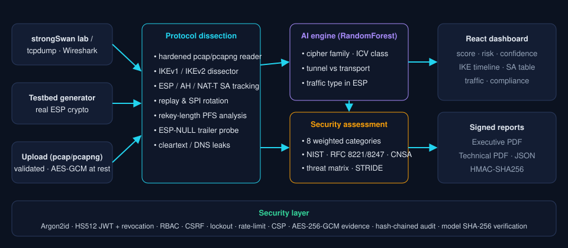

# IPsec Sentinel AI

**AI-Powered IPsec VPN Protocol Analyzer and Security Assessment Framework**
Smart India Hackathon 2026 · Problem Statement **SIH26160** · National Technical Research Organisation (NTRO) · Theme: Blockchain & Cybersecurity

IPsec Sentinel AI takes a packet capture of an IPsec VPN (pcap or pcapng, IPv4 or IPv6, with or without NAT-T), identifies the protocol configuration, uses machine learning to infer what cannot be read in cleartext, and produces a scored security assessment with signed Executive and Technical reports. **It does not need keys and does not decrypt anything.**



---

## Coverage of the problem statement

| PS requirement | Where it is implemented |
|---|---|
| **a) VPN testbed:** tunnel/transport, AES-128/256, AES-GCM, AES-CBC+HMAC, DH groups, PFS on/off, IPv4/IPv6, VoIP/WhatsApp/e-mail/web/ICMP/video | `backend/app/testbed/` is a traffic generator that really encrypts packets (Scapy SA crypto). It is exposed on the dashboard's **VPN Testbed** page. `testbed/` holds a real **strongSwan Docker lab** with 12 swanctl profiles and tcpdump capture scripts. |
| **b) Traffic capture:** IKE, ESP, AH, normal traffic | Captures contain the IKEv1/IKEv2 negotiation, ESP, AH, NAT-T (UDP 4500) and cleartext DNS. Output is Wireshark-compatible, checked with `tshark`. |
| **c) AI protocol identification:** IPsec, IKE version, mode, encryption, authentication, key exchange, SA characteristics, traffic type inside ESP | `backend/app/analyzer/`. A hybrid engine combines a hardened IKE dissector with 4 RandomForest models (cipher family, ICV class, tunnel/transport, application type) that work from side channels of the encrypted ESP. |
| **d) Security assessment:** crypto strength, compliance, SA parameters, key lifetime, replay protection, forward secrecy, cipher suite, metadata exposure | `backend/app/analyzer/assessment.py` scores 8 weighted categories and runs 13 compliance checks against NIST SP 800-77r1, RFC 8221, RFC 8247 and CNSA. |
| **e) Outputs:** security score, traffic analysis, metadata inference, Executive and Technical report, risk score, threat matrix, AI confidence | Dashboard plus PDF/JSON reports. Reports are HMAC-signed and bound to the result by SHA-256. The threat matrix is likelihood × impact with STRIDE and MITRE ATT&CK mapping. |
| **Deliverables** | Working prototype · AI engine · interactive dashboard · reports · demo script (`docs/DEMO_VIDEO_SCRIPT.md`) · technical docs (`docs/`) · dataset (`dataset/`) |

## Quick start

**Option 1: one command (Python 3.10+, Node 18+)**
```bash
./run.sh            # Windows: run.bat
# open http://127.0.0.1:8000  →  admin / Sentinel@Demo2026  (change it under Account)
```

**Option 2: Docker (hardened container: read-only, non-root, all capabilities dropped)**
```bash
ADMIN_PASSWORD='Your#Strong-Passw0rd' docker compose up --build
```

**Option 3: developer mode**
```bash
cd backend && pip install -r requirements.txt
ADMIN_PASSWORD='Sentinel@Demo2026' uvicorn app.main:app --reload --port 8000
cd frontend && npm install && npm run dev        # http://localhost:5173 (proxies /api)
```

**CLI (no server needed)**
```bash
cd backend
python -m app.cli analyze ../dataset/samples/06_insecure-aggressive-psk_icmp.pcap --pdf report.pdf
python -m app.cli generate --preset cnsa-suite-b --traffic voip --out lab.pcap
```

### 5-minute demo path
1. **Analyze Captures:** drop any file from `dataset/samples/`.
2. Open the result and go through the tabs: **Overview**, **Protocol Identification**, **IKE**, **SAs & Replay**, **Traffic & Metadata**, **Threat Matrix**, **Compliance**. Download the **Executive** and **Technical** PDFs.
3. **VPN Testbed:** choose `insecure-aggressive-psk`, set traffic to `voip` and tick *inject replay*, then click **Generate & analyse**. Open the **Ground Truth vs AI** tab to compare.
4. **AI Engine & Dataset:** shows confusion matrices, feature importances and the dataset distribution.
5. **Users & Audit:** click **Verify hash chain** to check the tamper-evident audit log.

## AI engine results (grouped hold-out, 20% of captures)

| Model | Classes | Accuracy | Macro-F1 |
|---|---|---|---|
| ESP cipher family | AES-CBC · AES-GCM · 3DES · NULL | **98.5%** | 97.0% |
| Integrity ICV class | 96 · 128 · 256 · AEAD | **96.3%** | 81.0% |
| Tunnel vs transport | 2 | **97.0%** | 96.8% |
| Traffic inside ESP | VoIP · WhatsApp · e-mail · web · ICMP · video | **99.8%** | 99.8% |

These numbers come from the synthetic testbed dataset (700 captures, 914k packets). Accuracy on real captures will be lower, and some attributes cannot be observed from ciphertext at all: the AES key length, and HMAC-SHA256 versus SHA512 in certain cases. The system says this through lower confidence scores and does not guess silently. See `docs/TECHNICAL_DOCUMENTATION.md` §6.

## Security of the platform itself

The platform uses Argon2id password hashing and HS512 JWTs. Tokens are revocable and bound to a token version, and travel in an HttpOnly, SameSite=Strict cookie backed by a CSRF header check. It enforces RBAC (admin / analyst / viewer), locks accounts after 5 failed logins, rate-limits requests, and checks upload type by magic bytes with a size cap. Evidence is **encrypted at rest with AES-256-GCM**, and a SHA-256 chain of custody is re-verified before every analysis. The audit log is a **tamper-evident SHA-256 hash chain**, reports carry an **HMAC signature**, and ML models are **integrity-checked before they are unpickled**. The server sends strict CSP and security headers and never leaks stack traces. The pcap parser is dependency-free and bounds-checked. Full details are in `docs/SECURITY.md`.

## Repository layout
```
backend/   FastAPI app, analyzer, AI engine, reports, testbed generator, tests (18 passing)
frontend/  React + Tailwind + Recharts dashboard (dist/ prebuilt)
testbed/   strongSwan Docker lab: 12 swanctl profiles, traffic + capture scripts
dataset/   labels.csv, crypto_features.csv, traffic_features.csv, samples/*.pcap
docs/      technical documentation, security, API, demo video script, architecture
```
